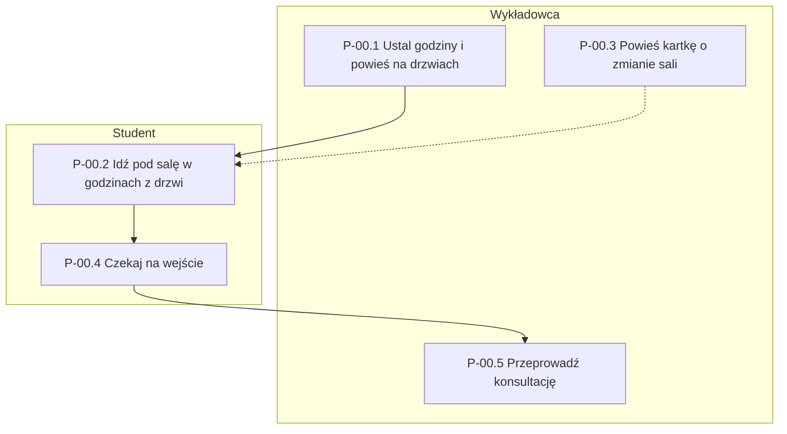

# P-00 AS-IS: obecny proces zapisu na konsultacje

Źródło: `docs/spotkania/wywiad-1.md` (U-01, cytaty 1–2). Wnioski oznaczone „wniosek” nie padły wprost w wywiadzie.

## Kroki

| Krok | Kto | Dokument / narzędzie | Problem |
|---|---|---|---|
| P-00.1 Wykładowca ustala godziny konsultacji | Wykładowca | podział godzin na drzwiach sali | informacja jest tylko pod salą |
| P-00.2 Student idzie pod salę w godzinach z drzwi | Student | kartka na drzwiach | student nie wie z góry, czy wykładowca jest (wniosek) |
| P-00.3 Gdy konsultacji nie będzie w tej sali, wykładowca wiesza kartkę o zmianie sali | Wykładowca | kartka na drzwiach | student dowiaduje się dopiero na miejscu (wniosek) |
| P-00.4 Student czeka na wejście | Student | — | brak zapisu, nikt nie wie, ilu studentów przyjdzie (wniosek) |
| P-00.5 Konsultacja | Student, Wykładowca | — | wykładowca nie ma listy osób (wniosek) |

Oficjalnego zapisu nie ma (U-01).

## Punkty bólu

| ID | Punkt bólu | Krok | Odpowiedź w TO-BE |
|---|---|---|---|
| B-01 | Brak oficjalnego zapisu | P-00.2 | P-01, FR-03 |
| B-02 | Godziny dostępne tylko na drzwiach | P-00.1 | FR-01, FR-02, FR-11 |
| B-03 | Zmiana sali tylko kartką | P-00.3 | P-02, FR-06, FR-12 |
| B-04 | Brak informacji o liczbie osób | P-00.4 | FR-10, BR-02 |
| B-05 | Wykładowca nie widzi zapisanych | P-00.5 | FR-10 |

## Diagram

