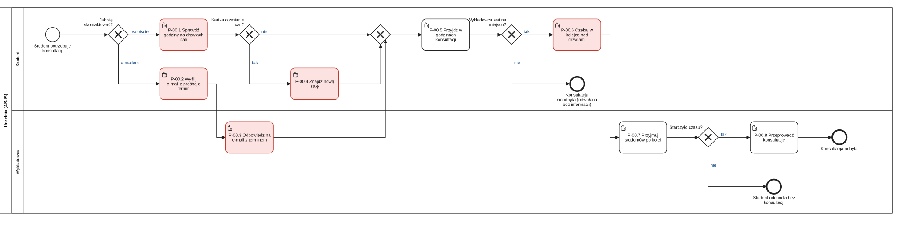

# P-00 AS-IS: Umawianie konsultacji

Diagram: `P-00-konsultacje-as-is.svg`

## Kroki i problemy

| Krok | Tor | Typ | Problem |
|---|---|---|---|
| P-00.1 Sprawdź godziny na drzwiach sali | Student | zadanie ręczne | termin znany tylko z kartki na drzwiach (N-01) |
| P-00.2 Wyślij e-mail z prośbą o termin | Student | zadanie ręczne | wiele wiadomości, chaos |
| P-00.3 Odpowiedz na e-mail z terminem | Wykładowca | zadanie ręczne | odpowiedź po kilku dniach |
| P-00.4 Znajdź nową salę | Student | zadanie ręczne | zmiana sali tylko na kartce (N-05) |
| P-00.5 Przyjdź w godzinach konsultacji | Student | zadanie ręczne | — |
| P-00.6 Czekaj w kolejce pod drzwiami | Student | zadanie ręczne | brak zapisu i limitu miejsc (N-03, N-07) |
| P-00.7 Przyjmuj studentów po kolei | Wykładowca | zadanie ręczne | wykładowca nie wie, kto przyjdzie (N-08) |
| P-00.8 Przeprowadź konsultację | Wykładowca | zadanie ręczne | — |

## Punkty bólu

| ID | Problem | Gdzie | Odpowiedź w TO-BE |
|---|---|---|---|
| PB-01 | Termin znany tylko z drzwi | P-00.1 | P-01.1 (FR-01, FR-02, FR-13) |
| PB-02 | E-maile i czekanie na odpowiedź | P-00.2, P-00.3 | P-01.2–P-01.5 (FR-03, FR-05) |
| PB-03 | Zmiana sali tylko na kartce | P-00.4 | P-02.6, P-02.7 (FR-12, FR-06, BR-05) |
| PB-04 | Odwołanie bez informacji | bramka „Wykładowca jest na miejscu?” | P-02.8, P-02.9 (FR-17, FR-19, BR-08) |
| PB-05 | Kolejka, brak limitu miejsc | P-00.6 | P-01.3, P-01.7 (FR-08, FR-18, FR-09, BR-02) |
| PB-06 | Wykładowca nie zna listy | P-00.7 | P-02.5 (FR-10) |

## Koniec procesu

- „Konsultacja odbyta”
- „Konsultacja nieodbyta (odwołana bez informacji)”
- „Student odchodzi bez konsultacji”
