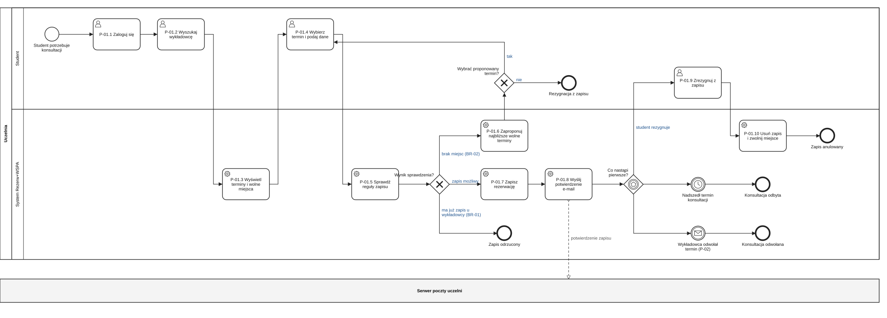

# P-01: Zapis studenta na konsultacje (TO-BE)

**Wersja:** 0.1 · **Powiązane:** P-00 (AS-IS), P-02

## Cel procesu

Student ma potwierdzony zapis na konsultacje u wybranego wykładowcy, a wykładowca wie, kto przyjdzie.

## Wyzwalacz (zdarzenie początkowe)

Student potrzebuje konsultacji.

## Uczestnicy (tory i pule)

- tory: Student, System Rezerw+WSPA,
- pula zewnętrzna: Serwer poczty uczelni.

## Wyniki (zdarzenia końcowe)

- konsultacja odbyta,
- zapis anulowany (rezygnacja studenta),
- konsultacja odwołana (przez wykładowcę, P-02),
- zapis odrzucony (student ma już zapis u wykładowcy),
- rezygnacja z zapisu (brak pasującego terminu).

## Diagram

Źródło: [P-01-zapis-na-konsultacje.bpmn](P-01-zapis-na-konsultacje.bpmn) (bpmn.io)

## Kroki

| Krok | Tor | Typ zadania | Opis | Wymagania |
|---|---|---|---|---|
| start | Student | zdarzenie | student potrzebuje konsultacji | — |
| P-01.1 | Student | użytkownika | zaloguj się na swoje konto | FR-15 |
| P-01.2 | Student | użytkownika | wyszukaj wykładowcę po nazwisku | FR-13 |
| P-01.3 | System | usługi | wyświetl terminy wykładowcy z godzinami, salą, przedmiotami i liczbą wolnych miejsc | FR-01, FR-02 |
| P-01.4 | Student | użytkownika | wybierz termin i podaj dane (imię, nazwisko, kierunek, godzina, nr indeksu) | FR-03, BR-04 |
| P-01.5 | System | usługi | sprawdź reguły zapisu: kompletność danych, wolne miejsca, brak innego zapisu u wykładowcy | FR-04, FR-08, BR-01, BR-02, BR-04 |
| bramka | System | XOR | wynik sprawdzenia? zapis możliwy / brak miejsc / ma już zapis | — |
| P-01.6 | System | usługi | zaproponuj najbliższe wolne terminy | FR-09 |
| bramka | Student | XOR | wybrać proponowany termin? tak → P-01.4, nie → koniec | — |
| P-01.7 | System | usługi | zapisz rezerwację (miejsce zajęte) | FR-03 |
| P-01.8 | System | usługi | wyślij potwierdzenie e-mail (sala, data, wykładowca) | FR-05 |
| bramka | System | oparta na zdarzeniach | co nastąpi pierwsze: termin konsultacji, rezygnacja studenta czy odwołanie przez wykładowcę? | — |
| P-01.9 | Student | użytkownika | zrezygnuj z zapisu (jedno kliknięcie) | FR-07, BR-03, NFR-01 |
| P-01.10 | System | usługi | usuń zapis i zwolnij miejsce | FR-07 |
| zdarzenie | System | wiadomości | wykładowca odwołał termin (z P-02.9) | FR-16, FR-18, BR-08 |
| zdarzenie | System | czasowe | nadszedł termin konsultacji | — |

## Wyjątki i ścieżki alternatywne

| Wyjątek | Gdzie | Reakcja | Wymaganie / BR |
|---|---|---|---|
| brak wolnych miejsc na wybranym terminie | P-01.5 → P-01.6 | system blokuje zapis i proponuje najbliższe wolne terminy; brak listy rezerwowej | FR-08, FR-09, BR-02, BR-06 |
| student ma już zapis u tego wykładowcy | P-01.5 | zapis odrzucony z komunikatem | FR-04, BR-01 |
| niepełne dane przy zapisie | P-01.5 | komunikat, powrót do P-01.4 (w diagramie w ramach sprawdzenia reguł) | BR-04 |
| student rezygnuje | P-01.9 | zapis usunięty, miejsce wolne | FR-07, BR-03 |
| wykładowca odwołuje termin | zdarzenie z P-02.9 | zapis anulowany, student powiadomiony | FR-16, FR-18, BR-08 |
| wykładowca zmienia salę | P-02.7 (proces P-02) | zapis pozostaje, student dostaje powiadomienie | FR-06, BR-05 |
| serwer poczty nie odpowiada | P-01.8 | zapis pozostaje ważny; potwierdzenie widoczne w systemie — **do ustalenia** | pytanie Q-10 |

## Zmiany względem AS-IS

- **znika:** sprawdzanie kartki na drzwiach i wymiana e-maili (P-00.1–P-00.3),
- **automatyzacja:** kontrola wolnych miejsc i reguły zapisu (P-01.5), propozycja innych terminów (P-01.6),
- **nowe kroki:** potwierdzenie e-mail (P-01.8), rezygnacja w systemie (P-01.9),
- **znika kolejka pod drzwiami** — student zapisuje się na godzinę (P-00.6).

## Otwarte pytania

- Q-06: czy można zrezygnować z konsultacji, która już się rozpoczęła? (P-01.9)
- Q-07: jak student loguje się do systemu — konto w systemie czy konto uczelniane? (P-01.1)
- Q-09: do kiedy przed konsultacją można się zapisać? (P-01.5)
- Q-10: co, gdy potwierdzenie e-mail nie dotrze? (P-01.8)
