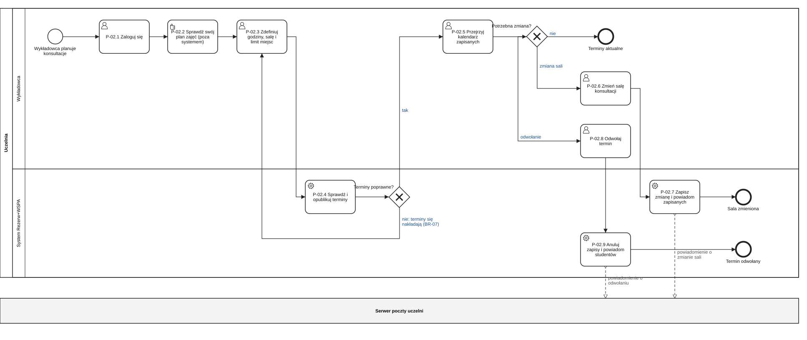

# P-02 TO-BE: Zarządzanie terminami konsultacji

Źródło diagramu: `P-02-zarzadzanie-terminami.bpmn`, eksport: `P-02-zarzadzanie-terminami.svg`

## Kroki i wymagania

| Krok | Tor | Typ | Wymagania |
|---|---|---|---|
| P-02.1 Zaloguj się | Wykładowca | zadanie użytkownika | FR-16 |
| P-02.2 Sprawdź swój plan zajęć | Wykładowca | zadanie ręczne | poza systemem (zakres OUT: import z USOS) |
| P-02.3 Zdefiniuj godziny, salę i limit miejsc | Wykładowca | zadanie użytkownika | FR-11, FR-18 |
| P-02.4 Sprawdź i opublikuj terminy | System | zadanie usługi | FR-11, BR-07 |
| P-02.5 Przejrzyj kalendarz zapisanych | Wykładowca | zadanie użytkownika | FR-10, NFR-04 |
| P-02.6 Zmień salę konsultacji | Wykładowca | zadanie użytkownika | FR-12 |
| P-02.7 Zapisz zmianę i powiadom zapisanych | System | zadanie usługi | FR-06, BR-05, OG-02 |
| P-02.8 Odwołaj termin | Wykładowca | zadanie użytkownika | FR-17 |
| P-02.9 Anuluj zapisy i powiadom studentów | System | zadanie usługi | FR-19, BR-08, OG-02 |

## Wyjątki

| ID | Wyjątek | Gdzie | Reguła |
|---|---|---|---|
| W-07 | Terminy wykładowcy nakładają się | P-02.4 | BR-07, powrót do P-02.3 |
| W-08 | Konsultacje kolidują z zajęciami wykładowcy | P-02.2 | sprawdzenie ręczne (zakres OUT) |
| W-09 | Inny wykładowca próbuje zobaczyć listę zapisanych | P-02.5 | NFR-04 |
| W-10 | Odwołanie terminu, na który są zapisani studenci | P-02.9 | BR-08 |

## Koniec procesu

- „Terminy aktualne”
- „Sala zmieniona”
- „Termin odwołany”
