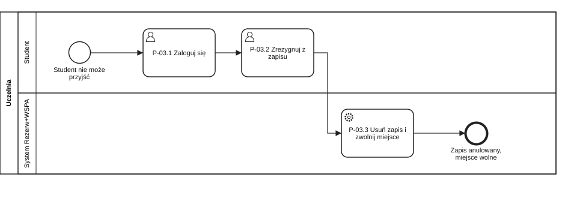

# P-03 TO-BE: Rezygnacja studenta z zapisu

Źródło diagramu: `P-03-rezygnacja-z-zapisu.bpmn`, eksport: `P-03-rezygnacja-z-zapisu.svg`

## Kroki i wymagania

| Krok | Tor | Typ | Wymagania |
|---|---|---|---|
| P-03.1 Zaloguj się | Student | zadanie użytkownika | FR-16 |
| P-03.2 Zrezygnuj z zapisu | Student | zadanie użytkownika | FR-07, BR-03, NFR-01 |
| P-03.3 Usuń zapis i zwolnij miejsce | System | zadanie usługi | FR-07 |

## Wyjątki

| ID | Wyjątek | Gdzie | Reguła |
|---|---|---|---|
| W-05 | Student próbuje zrezygnować z cudzego zapisu | P-03.2 | odmowa (US-02, scenariusz 2) |
| W-06 | Konsultacja już się rozpoczęła | P-03.2 | brak reguły, Q-06 |

## Koniec procesu

- „Zapis anulowany, miejsce wolne”
