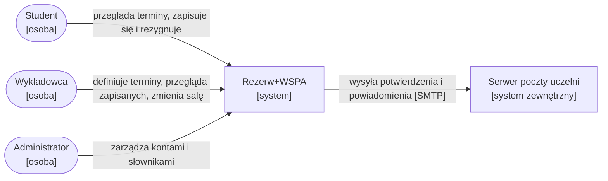

# C4 poziom 1: kontekst systemu

## Opis elementów

| Element | Typ | Opis | Właściciel / dane |
|---|---|---|---|
| Student | osoba | Zapisuje się na konsultacje i rezygnuje z nich. | imię, nazwisko, kierunek, numer indeksu |
| Wykładowca | osoba | Ustala terminy i sale, widzi listę zapisanych. | imię, nazwisko, terminy, przedmioty |
| Administrator | osoba | Zakłada i blokuje konta, uzupełnia słowniki. | konta użytkowników |
| Rezerw+WSPA | system | Platforma zapisów na konsultacje. | zapisy, terminy, konta |
| Serwer poczty uczelni | system zewnętrzny | Dostarcza e-maile z potwierdzeniami i powiadomieniami (OG-02). | adres e-mail studenta |

## Poza zakresem (OUT)

MS Teams, Zoom i USOS nie są częścią systemu.
